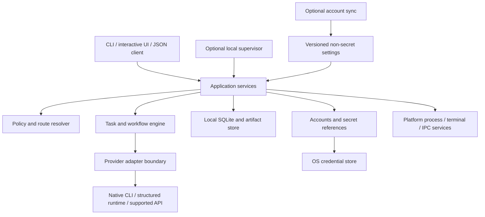

# UCLI architecture proposal

Status: planning baseline, 2026-10-17. This describes a new project, independent of cly/CLAI. No component below is implemented or verified merely because it appears here. Architecture decisions should preserve the user's primary outcome: start useful AI work quickly without remembering provider-specific syntax.

The current [application-owned execution host](owned-execution.md) implements the
worker/observer boundary inside one UCLI process. It reuses existing acceptance,
state and adapters; the separate process supervisor, native conversation reuse,
workflow execution and quota reservations below remain proposals. The
[terminal UI research](terminal-ui-research.md) records current interface references.

## 1. Assessment and governing decisions

The proposal is viable if UCLI standardizes user intent while retaining truthful capability boundaries. The largest risks are incomplete provider integration, account isolation, interruption recovery, and hidden startup work. Language choice helps distribution and local overhead, but cannot compensate for a provider probe or decision-model call before every prompt.

Recommend a **Go local core, structured provider adapters, local durable state, and an optional supervisor**. Keep a fast foreground path. Add the supervisor when background tasks and resumable workflows need it. GitHub-backed sync is an optional control plane; local execution remains available when it is offline.

The first release should prove a complete daily task across two providers before expanding the catalog. A provider counts as integrated only when its supported paths have evidence: discovery, identity, launch, stream, interruption, errors, and cleanup. Merely opening its executable is a narrower capability.

Three execution experiences share one vocabulary:

| Mode | User purpose | Architectural treatment |
|---|---|---|
| Unified foreground | Run or converse using familiar UCLI controls | UCLI owns presentation and task state; adapter translates requests and events |
| Managed work | Detach, reconnect, coordinate workflow steps | Supervisor owns workers and durable scheduling; CLI attaches as a client |
| Native session | Reach a provider's full original interface | Explicit terminal passthrough with declared limits on routing, structured events, and recovery |

Native mode is a useful escape hatch, but success in native mode does not establish universal-mode support. Existing cly remains independently installed and usable. Migration is an optional later import of selected non-secret settings with a reviewable diff.

## 2. Boundaries and dependency direction



The application layer contains decisions; renderers contain presentation; adapters contain provider behavior. No provider name belongs in a generic scheduler switch statement. No UI component writes a database row directly. Domain types must not import terminal, SQL, or provider SDK types.

| Boundary | Owns | Must not own |
|---|---|---|
| CLI and interactive UI | Parsing, discovery, accessible feedback, completion | Independent routing or credential logic |
| Application services | Resolve, start, cancel, resume, explain, inspect | Vendor response parsing |
| Policy/router | Eligibility, scoring, explanation, reservation requests | Relaxing permission constraints to find an available model |
| Task engine | Dependencies, attempts, checkpoints, completion evidence | Assuming a successful process exit proves task completion |
| Adapter | Capability translation, authentication interface, provider events | Choosing another account without application authorization |
| State | Transactions, projections, leases, migrations | Storing raw credentials in run records |
| Platform | Process trees, paths, terminal ownership, local IPC | Business policy |
| Sync service | Devices, preferences, workflow templates, connection labels | Requiring cloud availability for a locally authorized run |

The following is a proposed package layout, not permission to create empty scaffolding. Add packages when their first consuming feature needs them.

```text
cmd/ucli/                  entry point, version metadata
internal/cli/              commands and shell completion
internal/tui/              Phase 1 compact interactive home and task presentation
internal/app/              application service entry points
internal/domain/           IDs, requests, events, policies, attempts
internal/routing/          eligibility, ranking, explanations
internal/tasks/            execution state machine
internal/workflows/        dependency graph and checkpoint scheduling
internal/accounts/         connection registry, identity, refresh coordination
internal/adapters/         registry and trusted built-in adapters
internal/adapterhost/      external process protocol and validation
internal/state/            SQLite queries and ordered migrations
internal/artifacts/        atomic files, manifests, retention
internal/platform/         process, terminal, IPC, paths, secret-store ports
internal/platform/windows/ platform-specific implementations
internal/platform/unix/    shared POSIX implementations; macOS differences explicit
internal/supervisor/       optional service lifecycle and workers
internal/sync/             optional settings synchronization
protocol/                  versioned JSON schemas and examples
testdata/                  replay fixtures, never real tokens
tests/acceptance/          packaged CLI and real boundary checks
bench/                     reproducible overhead and stream workloads
docs/adr/                  consequential decisions and revisit conditions
```

Initially keep one module and one binary. Avoid microservices, a message broker, distributed scheduling, or an extension marketplace until a validated feature needs them. A pure core with explicit ports makes later extraction possible without paying its operating cost now.

## 3. Intent, capabilities, and immutable execution plans

Keep these separate: model, provider runtime, account connection, preset, task, and run attempt. A task can survive many attempts; a provider session belongs to a particular runtime/account context. Changing a model does not imply that another runtime can resume its private session.

Resolve an invocation into an immutable execution plan containing the requested and effective model/effort, runtime identity and version, account connection ID, workspace identity, policy, budget, context references, adapter version, and route rationale. Store configuration provenance so an explanation can identify a project setting or explicit flag. Secrets remain opaque references.

The effective-configuration precedence and active-task change rules in [contracts.md](contracts.md#effective-configuration) are authoritative. All entry points use that resolver; interface defaults and adapter preparation cannot introduce a second precedence order.

Explicit selections constrain the router. `auto` permits selection only within the user's eligible pool. Common effort labels express intent; adapters publish supported native values and mappings. Unsupported explicit settings fail with a useful alternative. Automatic mappings may select an eligible native setting and must expose the effective result.

Capabilities are structured and scoped: interactive, headless, streaming, approvals, cancellation, session resume, model discovery, effort control, usage observation, isolated accounts, concurrent accounts, and workspace restriction. Each can carry support level, integration version, evidence date, and limitations. Account-specific model access is distinct from the provider's general catalog.

Separate static runtime capabilities from route-specific observations. Static discovery is keyed by executable/service identity and version. Route evidence additionally includes endpoint, connection/auth scope and generation, model, workspace/trust context and relevant configuration revision. Reconnect, binding changes and scope changes invalidate affected observations; another account cannot inherit entitlement evidence because it uses the same executable. Do not launch every installed provider for help or an already resolved run. Refresh on explicit inspection, expiry or a relevant failure. Provider extension fields preserve new vendor features without silently making them stable UCLI flags.

## 4. Adapter and extension contract

Prefer documented structured runtime protocols or SDKs. Use stable machine-readable CLI output next. Terminal-only integration is declared native passthrough. Screen scraping must not become the source of truth for quota or approvals.

Trusted built-ins implement a typed Go interface. External adapters use versioned JSON-RPC over stdin/stdout with a bounded newline-delimited UTF-8 frame format; stderr carries adapter diagnostics. Both conform to the same semantic contract and fixtures. Requests include request/run IDs and deadlines; streamed notifications include run ID and monotonic sequence number. Chunk large content or use scoped artifact references rather than unbounded frames.

An initial handshake negotiates protocol major/minor range, capabilities, adapter identity, and runtime executable or service identity. Unknown optional fields may be preserved or ignored; unknown required semantics fail closed. Never guess compatibility after a major mismatch. Maintain a compatibility table and replay fixtures for the supported provider versions. Extension version and provider version are separate axes.

Start external adapters lazily. Keep a session process alive only when the adapter proves this is useful and supports cleanup. Apply bounded queues, cancellation, parser limits, and restart budgets. A crashed adapter becomes a typed failure, not a frozen terminal.

Installing an adapter authorizes executable code under the current user. A separate process contains crashes; it does **not** sandbox filesystem or network access. Registry metadata, signatures, and checksums establish provenance, not harmlessness. Default to first-party shipped adapters; require deliberate installation of third-party code. Do not execute adapters from a repository's configuration automatically. Pin installed artifacts and record update provenance. A stronger sandbox is a future capability with explicit platform tests, not a claim supplied by the plugin manifest.

## 5. Account isolation, identity, and authorization

GitHub login identifies a UCLI user and optional sync account. Provider connections remain separately authorized. Connection records contain an opaque ID, provider, user-chosen label, verified identity summary, allowed purpose/projects, secret reference, and health. Labels and email addresses are not primary keys.

Local operation should require only the provider connection needed for the task. Sync stores preferences and connection metadata by default. Reconnecting a new device is preferable to silently replicating subscription refresh tokens. Remote credential custody, if ever requested, needs its own design and provider support.

Prefer supported provider profile/config roots. Every launch receives an explicit environment, working directory, and credential context. Do not swap the user's global login file. Isolating a directory is insufficient if the runtime uses a shared daemon, keychain item, global cache, fixed port, or refresh-token store. Each adapter must prove which resources are isolated and advertise sequential-only support when concurrent isolation is unavailable.

Serialize refresh for the same connection; persist a credential generation marker without the secret. Rotation must not race two workers or overwrite a newer token. Keep accounts fixed for an active provider session. Account changes occur at a safe task boundary with a fresh attempt/context handoff unless the provider supports and validates a stronger operation.

Resolve permissions before execution. Record requested policy, effective provider enforcement, and unsupported restrictions. Approval requests have stable IDs tied to the exact action, workspace, run, and expiry. Cancellation invalidates outstanding requests. An unattended worker enters a blocked state when authorization is required. An adapter that cannot enforce a requested restriction is ineligible; UCLI must not imply that an arbitrary native subprocess is sandboxed.

## 6. Durable state and ownership

Use SQLite for local operational state and a sibling artifact directory for large outputs. WAL permits concurrent readers and a serialized writer; it requires a local same-host database. Keep transactions short, configure bounded busy handling, and never hold a transaction while waiting on a model or network call. [SQLite WAL documentation](https://www.sqlite.org/wal.html)

Pin a supported database engine containing the WAL-reset fix: upstream documents SQLite 3.51.3 and later, plus specific backports. Verify the bundled engine version through the driver at runtime and in CI. A dependency module version alone is insufficient evidence. [SQLite WAL-reset advisory](https://www.sqlite.org/wal.html#walresetbug)

| Data | Durable owner | Sync default |
|---|---|---|
| User/project presets, aliases, workflow definitions | Versioned configuration | Eligible non-secret fields only |
| Tasks, attempts, dependencies, leases, approvals | SQLite | Local |
| Usage observations and in-flight reservations | SQLite, with source and timestamps | Local; cross-device accounting is a later design |
| Provider session IDs and context manifests | SQLite | Local |
| Output, checkpoints, diffs, receipts | Artifact files with hashes | Local |
| Tokens and refresh material | OS credential store or provider-supported store | No |
| GitHub device and sync credentials | OS credential store | No |

Use transactional state transitions plus an append-only event history; do not introduce full event sourcing. Critical events and state changes commit together. Stream deltas can be batched; final outputs, approvals, attempt starts, and completion receipts require durable acknowledgment. Write artifacts to temporary files and atomically finalize them before recording their manifest. Recovery detects incomplete files and unreferenced outputs.

Use stable generated IDs. Ownership leases include an epoch/fencing value, process identity, and heartbeat. A scheduler claims work transactionally, preventing two UCLI processes from starting the same attempt. Lease expiry alone never proves an external provider stopped. Reconcile provider/process state first; unresolved attempts become `unknown` and require a safe recovery path.

Reservations coordinate local competing attempts against known shared quota buckets. They are estimates, not proof of provider capacity. External native clients and other devices can consume the same allowance; observations retain uncertainty and reset-window identity. Persist absolute reset timestamps, use monotonic time for live deadlines, and re-evaluate after suspend or clock changes.

Database migrations run under an exclusive migration lock before writes, with a verified backup and explicit compatibility version. The maintenance barrier in [contracts](contracts.md#task-and-process-persistence) also excludes already-running incompatible writers; startup-only checks are insufficient and hot migration is out of scope. Older binaries refuse incompatible writes. Use SQLite backup mechanisms rather than copying a live database alone. Keep live state off network mounts and sync folders; sync exports/configuration, never a running WAL directory.

## 7. Process lifecycle, streaming, and platform behavior

Pass argument arrays directly to executables. Avoid shell command construction. Handle Windows wrappers through a narrowly tested launcher rather than concatenating user prompts into `cmd.exe`. Resolve executable identity carefully and preserve spaces, Unicode, and long-path behavior. Go's process API does not invoke a shell by default; its cancellation and pipe-wait behavior still needs explicit application handling. [Go os/exec](https://pkg.go.dev/os/exec)

The platform layer owns process trees. Windows uses Job Objects with tested nested-job behavior and no-console flags for background children. POSIX uses process groups and staged signals. Both need bounded shutdown, output draining, and explicit handling of descendants that outlive their parent. Windows Job Objects can manage grouped processes, but documented breakaway exceptions must be part of the acceptance tests. [Microsoft Job Objects](https://learn.microsoft.com/en-us/windows/win32/procthread/job-objects)

Cancellation first requests a provider interrupt, then escalates after a deadline. Record whether the operation was interrupted cleanly, terminated, or left with unknown external effects. Never kill unrelated terminals or processes by executable name. PID plus creation identity protects against PID reuse.

Read stdout and stderr concurrently; incremental parsers must handle split UTF-8 and partial frames. Bound buffering. Backpressure must not deadlock a child that is waiting for input or an approval. Coalesce display updates, preserve semantic event order, and flush final output before reporting completion. Keep machine output on stdout and human diagnostics on stderr. Sanitize terminal control sequences in unified output; native mode deliberately delegates terminal rendering.

Treat a closed client pipe or lost terminal as a connection-loss event, distinct from user cancellation. Managed mode removes the subscriber while the supervisor retains ownership. Foreground mode attempts a bounded stop and output drain for its owned children; record interrupted work when stopping is confirmed, or an unknown outcome when process/provider state remains uncertain. Connection loss never establishes a checkpoint or proves that external effects stopped. Executor ownership is selected at launch. Detach acknowledges the supervisor's existing durable ownership before removing the UI; arbitrary live foreground process adoption is not promised. Application services remain independent of the hosting terminal/process.

Platform implementations cover paths, permissions, keychain access, terminal resize/raw mode, signals, local IPC, service registration, and atomic replacement. Linux respects XDG configuration/data/cache/state locations. Windows uses appropriate per-user application directories; macOS uses its standard application-support and cache locations. [XDG base directory specification](https://specifications.freedesktop.org/basedir/latest/)

Use per-user Unix sockets or access-controlled Windows named pipes for optional supervisor IPC. Authenticate local clients and protocol versions; no unauthenticated TCP listener. The supervisor is a user process, starts only when needed, and can shut down when idle. Installation as a login service is optional. Initial foreground support does not promise survival after its terminal closes.

## 8. Recovery and extensibility gates

| Failure | Required behavior |
|---|---|
| Provider busy or quota exhausted | Preserve attempt/context, classify cause, offer or apply only authorized fallback |
| Network loss after submission | Reconcile status; avoid blind replay of potentially mutating work |
| Adapter malformed frame/crash | Bound failure, retain diagnostics, stop affected attempt |
| Disk full or store unavailable | Stop accepting durable work; never claim a checkpoint exists |
| Supervisor crash/reboot | Recover leases, inspect attempts, resume only safe/reconciled work |
| Credential revoked | Isolate connection failure; preserve unrelated account runs |
| Provider upgrade changes schema | Disable affected capability with a recovery path; retain native mode if safe |
| Workflow worker failure | Preserve completed outputs; retry only the failed eligible step |

Workflow steps have typed input/output manifests, dependencies, resource needs, completion criteria, and retry policy. Assign editing work to isolated worktrees or explicit ownership domains. A model-generated workflow cannot grant itself permissions. Context handoffs include concise decisions and artifact references, with secret filtering and size limits.

The following remain hypotheses until spikes establish them: two initial providers can offer useful structured parity; supported profile roots fully isolate accounts; chosen SQLite and credential-store dependencies preserve packaging simplicity; a small team can maintain Go platform bindings; and real terminals meet the latency budgets. Gate implementation on those results rather than growing a universal abstraction around untested promises.
