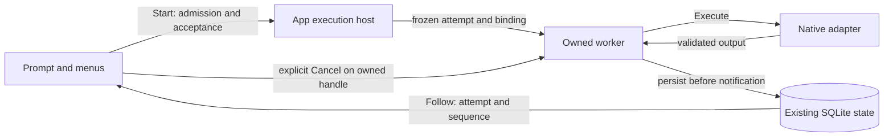

# Application-owned execution

Accepted work belongs to the application host. The rich terminal is an observer
and an explicit source of commands; its writer is no longer on the adapter's
output callback. This host runs inside the UCLI process. Closing that process
still ends its lifetime; there is no detached daemon or implicit native resume.

## Module boundaries

| Module | Responsibility |
|---|---|
| `app.go` preparation | Validate intent, preserve draft conflicts, replay commands, resolve exact route, accept atomically |
| `coordinator.go` | Bound admission/work, own accepted lifetimes, expose handles, cancel and join before store shutdown |
| `execution.go` | Execute the admitted adapter, persist deltas/native references and classified terminal receipts |
| `follow.go` | Independently replay bounded durable pages, validate identity/sequence, wait on coalesced hints |
| CLI controller | Keep composition and menus available, observe captured attempts, request explicit Stop |
| Terminal transcript | Keep interleaved responses in records keyed by full task/attempt identity |

All adapters retain `Driver.Execute`. No second scheduler database, network bus,
provider tool loop, installation path or account store is introduced.

## Lifetime contract

`App.Start(ctx, options)` finishes admission and durable acceptance before it
returns an `Execution`. The context can cancel admission; after acceptance the
worker belongs to the App. An explicit context deadline is retained. Options and
the editing revision are captured; later draft/model/account changes cannot
retarget accepted work. Native admission is still synchronous and can take
seconds; this change does not remove or cache fresh account/configuration checks.

- `Accepted()` returns a copied receipt, not mutable worker state.
- `Wait(ctx)` limits only waiting. Canceling that wait does not stop execution.
- `Follow(ctx, afterSequence, emit)` limits one observer. Its error or canceled
  context detaches that observer; it never enters the adapter's output path.
- `Cancel()` requests stop of the exact locally owned attempt. Foreign receipt
  replay does not grant cancellation authority. A request is not terminal proof.
- `Done()` means the local worker returned, or a handle is receipt-only. It does
  not certify that unknown/foreign provider work has stopped.

`App.Run` remains the synchronous compatibility path. It observes the same host,
waits through presentation errors and maps explicit caller cancellation to a stop
request. Post-cancel waiting is bounded; a deadline cannot manufacture a terminal
result. Command replay still returns its existing receipt before fresh dispatch
admission, including when the host has reached its active-worker limit.

## Observation and limits

Durable events remain authoritative. An observer captures the change hint before
reading, drains at most 100 events per read and waits only when caught up. Hints
coalesce and contain no text; a 250 ms fallback sees writes made through another
App/process. A reconnect uses the same attempt ID and last successful sequence.
Cursor/identity gaps fail the reader without restarting inference.

The host bounds preparation/active workers to eight, concurrent admission checks
to sixteen, and callback workers to sixteen, including callbacks that ignore
cancellation. A stalled callback retains its observer slot until it returns.
It does not hold the database or block worker shutdown. Existing 4 MiB result,
event-page and terminal-display bounds still apply. The host-wide wake hint is
deliberately simple: at eight active workers it may wake unrelated readers;
per-attempt hints are a later optimization if measurement justifies them.

`App.Close` first rejects new admission and cancels admission/work, then joins
before closing SQLite. Its ten-second wait is bounded. If a driver ignores stop,
the store stays open and a single joiner closes it only after owned work returns.
Running/unknown attempts retain the existing durable fences. The host never
adopts a worker by PID or clears a lease because a local timeout elapsed.

## User loop and interruption

In the rich terminal, Enter acknowledges acceptance and returns to the composer.
The user can keep writing, open inspectors or select another task. Enter on a
busy owned task preserves the new draft and explains that it was not queued or
sent. `/stop`, also present in Tab actions and slash completion, targets only the
current task's owned live handle. Stopping does not erase its unsent composition.
Ordinary scripted/plain runs retain synchronous result behavior.

Worker observers capture task/attempt/model values and never mutate the active
task, draft, editing revision or independent pins. Late completion can announce
its own task but cannot reselect it. Scoped assistant records cannot append to a
different attempt's reply, including when multiple workers use the same model.
Failures retain a task-labelled diagnostic and the saved error for inspection.

The first Ctrl+C still requests confirmation; the second interrupts/exits and
requests stop of the process's workers. A broken writer instead detaches the UI
and keeps the host alive until accepted work settles. The independent control
context still allows explicit interruption, followed by bounded shutdown.
Normal EOF or `/exit` closes the host and requests stop. It is not a detach action.

## Future process boundary

A future supervisor can consume this same acceptance/worker/observer split with
authenticated local IPC. It needs its own launch/handshake, same-user access
controls, bounded protocol and parent-exit checks. Windows kill-on-close provider
jobs stay owned by that supervisor; they cannot simply be reparented from a UI.
Native conversation continuation remains separately gated by provider/account,
workspace, permissions and verified resume capabilities. Process reuse does not
establish native conversation memory.

See [agent communication](agent-communication.md), [conversation UI](conversation-ui.md),
[terminal research](terminal-ui-research.md), and [verification](verification.md).
